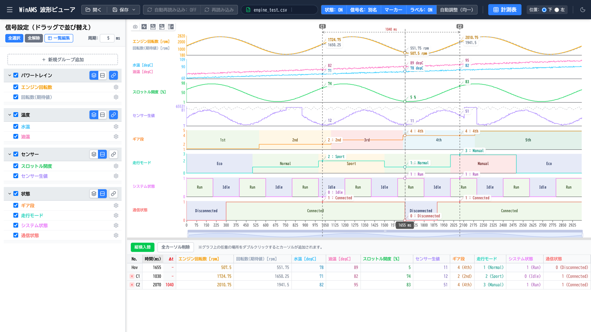
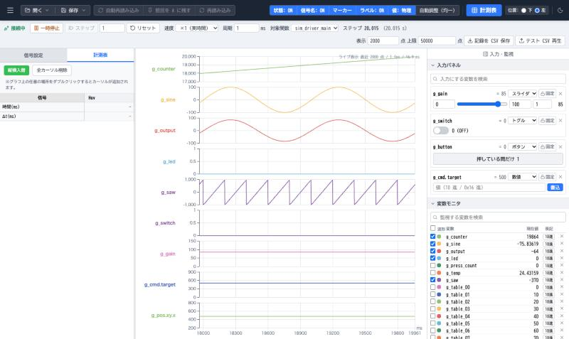
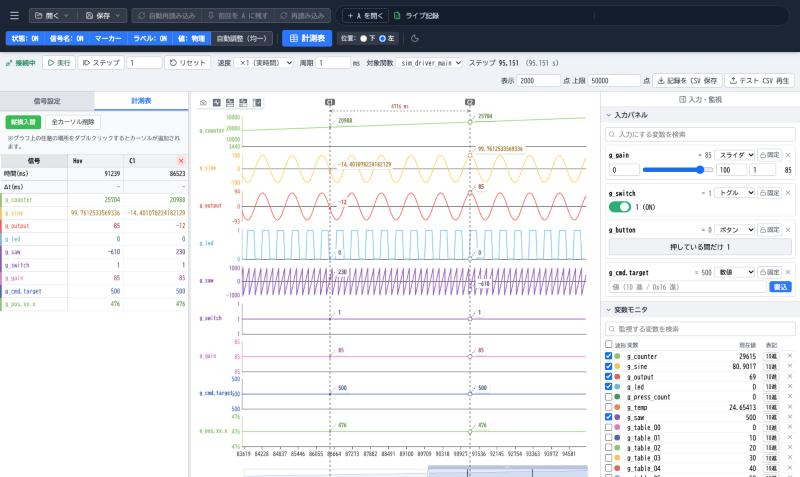
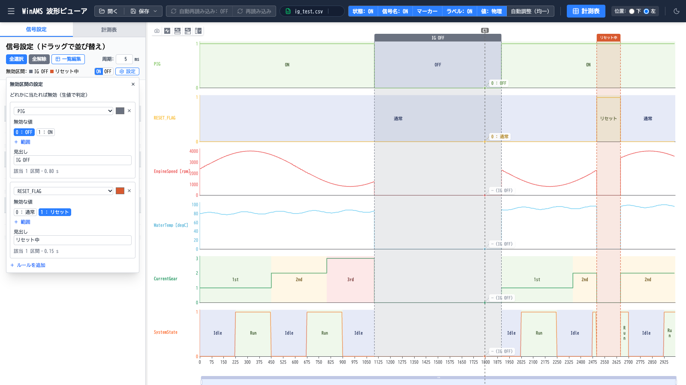
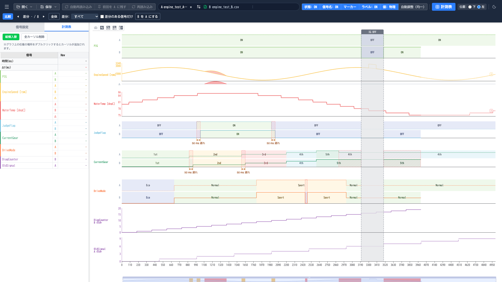

# WinAMS 波形ビューア

ブラウザだけで動く、WinAMS の出力結果や計測データ向けの波形ビューアです。
波形 CSV と信号定義ファイル（YAML / CSV）を読み込み、物理値への変換、グループ分け、カーソル計測、画像コピーまでをブラウザ内で行います。
サーバーは不要で、ビルドすると HTML ファイル 1 つ（`dist/sim_gui.html`）になります。
`sim gui` から開くと、シミュレータの変数をリアルタイムに流して操作するライブモードになります（[ライブモード（sim gui）](#ライブモードsim-gui)）。



> 図解入りの使い方ガイドは [README.html](README.html) を参照してください。

## 主な機能

| 分類 | 機能 |
| --- | --- |
| 読み込み | 波形 CSV・信号定義（YAML / CSV）・プロジェクト（.wcp）を「開く」ボタンまたはドラッグ＆ドロップで読み込み。複数ファイルを同時に指定できます。 |
| 波形比較 | 比べる元の A と比べる B の CSV を重ね、値の違いと状態信号のタイミングのずれを確認します。差分への移動・絞り込み、A / B / Δ の計測に対応します。 |
| 自動再読み込み | 読み込んだ波形 CSV の変更を監視し、更新されたら表示状態を保ったまま読み直します（Chrome / Edge）。手動の「再読み込み」ボタンもあります。 |
| 物理値変換 | 信号ごとに LSB・オフセット・単位を設定（物理値 = 生値 × LSB + オフセット）。`2^-8` や `1/256` のような式も使えます。ツールバーで物理値と生値の表示を切り替えられます。 |
| 状態表示 | 数値を状態名（例: `1: Active`）に対応づけ、波形上に背景色付きの文字で表示します。 |
| 無効区間 | IG OFF やリセット中など、条件信号の値で決まる区間を帯で示し、その間の波形を薄く、状態名と計測値を「— (IG OFF)」のように表示します。 |
| グループ | 信号をグループにまとめ、レーン表示／重ね表示、Y 軸レンジの同期を切り替えます。ドラッグ＆ドロップで並べ替えできます。 |
| Y 軸 | Auto または Min / Max 固定。無効値（除外値）が通常の範囲から大きく離れているときは、間を省略（Break）して表示します。 |
| 一覧編集 | 全信号の設定を表形式で編集。複数行の一括設定、Excel との表のコピー／貼り付けに対応します。 |
| 計測 | ダブルクリックでカーソル（C1, C2, …）を追加し、各時点の値とカーソル間の Δt を計測表で確認します。 |
| 出力 | 波形のみ、または波形と計測表を並べた画像をクリップボードへコピーします。 |
| 保存 | 設定を YAML で保存、または波形・設定・表示状態をまとめてプロジェクト（.wcp）として保存します。 |
| 表示 | ライト／ダークテーマ、サイドバーの折りたたみ、レーン高さの自動調整（均一 / 最適化 / 手動）。 |

## ライブモード（sim gui）

実行中の波形も左の信号設定の並び・グループ・チェックに従います。変数モニタの「波形」は左のチェックと同じ設定です。
重ね表示のグループは同じレーンに描き、信号が多いと各レーンが細くなります。入力パネルに新しく追加した変数も、既定で波形に表示します。

`sim gui` が配るページとして開くと、起動時に同じサーバの `/api/info` を確かめてライブモードになります。
HTML ファイルを直接開いたとき（`file://`）やサーバが答えないときは、これまでどおりのファイルを読む Viewer として動きます。



| 部分 | できること |
| --- | --- |
| 接続バー | 実行 / 一時停止 / ステップ実行（N 周期）/ リセット、速度倍率（×0.1〜×100、最速）、周期（ms）、対象関数、現在のステップ、オーバーラン表示、シミュレータのエラー表示。記録の CSV 保存（WinAMS 形式）とテスト CSV の読み込み再生。 |
| 波形（実行中） | 変数モニタで「波形」に印を付けた変数を、直近の点（既定 2000 点。接続バーの「表示」で変更）だけ軽い描画で流します。Canvas に直接描くので、20 本あまりの信号でも 1 回の描画は数ミリ秒です（記録が届くたび、1 秒に 30 回まで）。実行中も停止時と同じレーン配置・単位つき信号名・縦軸で描きますが、横軸の表記と縦軸の省略は簡略です。実行中の波形も状態表示（ツールバーの「状態」）に従います。キャプチャなどの操作は、一時停止か終了後の表示で行います。 |
| 波形（一時停止中） | 手元に残した記録の全区間を、従来の Viewer としてズーム・カーソル計測・物理値変換・状態名つきで見られます。一時停止した直後は、直前まで見ていた範囲を表示します。 |
| 入力パネル | 変数を検索して追加し、数値入力、スライダ（最小・最大・刻みを設定）、トグル（0/1）、押している間だけ 1 になるボタンで値を書き込みます。「固定」で毎周期書き込み続けます。書いた値は次のステップの開始時に反映され、それまで「反映待ち: 値」と表示します。数値入力はテスト CSV のセルと同じ書式（10 進、`0x` 16 進、負数、浮動小数、`'文字列'`、`1\|2\|3`）で書け、書いた表記のまま（前後の空白だけを除いて）サーバへ送ります。2^53 を超える 64 ビット整数も丸めずに書け、16 進で書いた値は記録にも 16 進で残ります。読めない値はサーバのメッセージをそのまま表示します。 |
| 変数モニタ | 監視変数の現在値を 10 進 / 16 進で表示し、追加・削除、波形に出すかを切り替えます。構造体や配列は ▸ で展開してメンバを選べます。 |

入力カードは左のつまみをドラッグして並べ替えられます。並び順も保存します。新規入力は数値・スライダ・トグル・状態の「固定」が既定で ON で、最初の値を入れるまでは「値を入れると固定します」と案内します。値を書くと毎周期書き続けるため、リセット後もその値を保ちます。ボタンと既存の保存済み入力の固定設定は従来どおりです。

波形設定（yaml を含む）の lsb・offset に換算があれば、数値入力とスライダは物理値で入力・表示します。単位は欄の右に表示し、整数型には生の値に逆換算して四捨五入した値を書き、実際に書いた物理値を欄へ戻します（例: lsb 0.1、offset -40、入力25.06 → 生651 → 表示25.1）。現在値・反映待ち・固定値も物理値で表示し、「物理値」の印や各値の上にマウスを置くと生の値を確認できます。保存値は常に生の値です。換算がない数値入力の書式と精度は従来どおりで、トグルとボタンは生の値を使います。

状態名が設定された変数は、新規追加時の種類が「状態」になります。値と状態名の一覧から選ぶとその値を書き、一覧にない値は「（値 N）」と表示します。既存カードも状態名があれば種類を「状態」に切り替えられます。

入力パネルと監視一覧は、仕向を選んでいるときは仕向ファイルに、「選択なし」のときはブラウザ（localStorage）に保存します。表示点数と記録の上限はブラウザに保存し、次に開いたときに復元します。

入力パネルで書いた値は、一時停止中も含めてすぐにはメモリへ書かれず、次のステップ（周期）の開始時に書かれます
（保存した記録を `sim run` で再実行したときと同じ順序にするため）。

- 反映を待っている値は、その入力に「反映待ち: 値」と出ます。ステップを進めると反映されて消えます。リセット・対象関数の変更でも消えます。
  同じ変数に続けて書くと、最後に書いた値だけが反映されます。
- 変数モニタと入力パネルの「= 現在値」は、メモリの実際の値です。一時停止中に書いても、ステップを進めるまでは変わりません。
  現在値は JSON の数値で届くため、2^53 を超える整数は丸められている可能性があり、末尾に `≈` を付けます（マウスを載せると説明が出ます）。
  こうした現在値は固定やボタンの復帰の値として送り返さず、値を入力するよう知らせます。
- トグルと「押している間だけ 1」のボタンは、反映待ちの値 → 固定の値 → 現在値 の順に、最初にあるものを元に反転・復帰します。
  一時停止中にトグルを 2 回押せば元の値に戻ります。ボタンは離すと押す前の値に戻します。
  スライダと数値入力も、反映待ち・固定の値があればそれを表示します。
- 「固定」が ON の入力に書いた値は、固定する値の更新になります（毎周期その値を書き続けます）。固定を OFF にすると、その変数の反映待ちも捨てます。
  固定した変数に単発で書いても、その周期は固定の値が採られます（単発 → 固定 → テスト CSV の再生 の順で後のものが残ります）。
- ポインタの先が NULL など、書く時点のメモリで決まる誤りはステップ時に起き、接続バーに赤く表示して知らせます（実行・ステップ・リセットなどの次の操作で消えます）。
  型に収まらない値などは、書き込んだ時点で失敗として知らせます。

テスト CSV の読み込み再生には、`sim run` と違う点が 2 つあります（UTF-8 は BOM 付きでも読めます。UTF-16 や NUL バイトを含むファイルは読み込めません）。

- 同じ名前の入力列が複数ある CSV（`P1,P1_bit.no0,P1` など）は読み込めません。重なっている名前と列番号をエラーで知らせ、
  記録・波形・入力パネル・監視は読み込む前のまま残します。こうした CSV は `sim run` で実行してください
  （`P1` と `P1_bit.no0` のように名前が違えば、同じメモリを指していても読み込めます）。
- `mod` ブロックが 2 つ以上ある CSV は、先頭のブロックだけを再生します。読み込んだときに、ブロックの数と
  2 つ目以降を再生しないことを警告で知らせます（読み込み成功の通知とは別に、しばらく画面に残ります）。

対象関数を変えると、シミュレータはリセットして記録を消し（手元の記録とライブ波形も消えます）、読み込んだテスト CSV の再生もやめます。
新しい関数で使えなくなった固定（前の関数の `@引数` など）は解除され、監視からも外れます。外したものは名前と理由を画面に知らせ、
入力パネルではその変数の「固定」を OFF にして現在値を「—」で表示します（書き込めたとき・入力に追加し直したときに監視へ戻ります）。

手元に残す記録は信号あたり既定 50,000 点（周期 5ms で約 4 分）で、超えた分は古い側から捨てます（接続バーの「上限」で変更）。
開始からの全記録は「記録を CSV 保存」で取れます。

一時停止したときや、長い CSV を開いたときの波形は、見えている範囲を画面の幅ほどの区間に分け、区間ごとの最初・最小・最大・最後の点だけを描きます。
1 点だけのパルスや値なしの途切れも残ります。拡大して点が少なくなれば、全点を描きます。カーソルの値は、絞る前の全点から読みます。
点数が多いほど少しずつ重くはなります（15 信号の手元の計測で、カーソルの移動 1 回が 6 万点で約 0.2〜0.5 秒、20 万点で約 0.5〜0.9 秒。
全点を描いていたときは 6 万点で約 2〜4 秒）。



## 使い方

### 1. ファイルを開く

ツールバーの **「開く」** を押すか、ファイルを画面にドラッグ＆ドロップします。

- 波形 CSV と設定 YAML を同時に指定すると、波形を読み込んでから設定を適用します。
- `.wcp` を指定すると、保存時の状態（波形・設定・ズーム・カーソル・テーマなど）をそのまま復元します。

### 2. 波形を操作する

- マウスホイールでズーム、ドラッグで左右に移動します。チャート下部のスライダーでも表示範囲を変えられます。マーカー表示中は、スライダーにもカーソルの位置を実線で示すので、表示範囲の外にあるカーソルの位置も分かります。波形上でマウスを動かすと、その位置もスライダーに点線で示します。
- 波形上にマウスを置くと、その時点の全信号の値を表示します。ツールバー中央にはマウス位置の信号名が出ます。
- ツールバーの切り替えボタン:

| ボタン | 切り替え内容 |
| --- | --- |
| 状態: OFF / 背景 / ON | 状態名の表示（背景色のみ、背景色＋文字） |
| 信号名: OFF / ON / 別名 | 波形左側の信号名ラベル。「別名」で YAML の `alias` を表示 |
| マーカー | カーソルの縦線と、カーソル間の時間差矢印。下のスライダーにもカーソルの位置を実線で出します（マウスの位置は点線） |
| ラベル: OFF / 値のみ / ON | カーソル位置の値ラベル |
| 値: 物理 / 生値 | グラフと計測表の値を、物理値と CSV の生値（LSB・オフセット適用前）で切り替えます。生値表示では、グラフの信号名の単位が `[raw]` になり（状態名を定義した信号は単位なし）、計測表には単位を付けません。ボタンは物理値表示で青、生値表示でオレンジになります。状態名の表示、手動の Y 軸範囲と Y 軸省略の位置は切り替えても変わりません。この切り替えは保存されず、開き直すと物理値表示に戻ります |
| 自動調整（均一 / 最適化 / 手動） | レーン高さの割り当て方。最適化は信号の値の種類や振れ幅から高さを決めます |
| 計測表 / 位置: 下・左 | 計測表の表示と、置き場所（画面下 / サイドバー内） |
| ☀ / 🌙 | ライト / ダークテーマ |

信号名の表示は最後の `/` より後ろだけにし、同時表示する信号と短縮名が重なる場合や末尾が `/` の場合は完全名を残します（別名表示時は別名を優先）。短縮表示にはマウスオーバーで完全名を出します。sim との通信（監視・書き込み・固定）と仕向ファイルには完全名を使います。

信号の設定（色・グループ・LSB・状態名など）は、波形 CSV とライブで同じ名前で持ちます。`engine.c/s_cnt` のようなファイル名つきの名前は `s_cnt` として扱うので、CSV の列 `engine.c/s_cnt` も、ライブで監視している `engine.c/s_cnt` も、yaml の `s_cnt` の設定を使います。同時に扱う信号に同じ短い名前のもの（`a.c/s_cnt` と `b.c/s_cnt`）があるときだけ、区別できるところまでファイル名を残した名前（`a.c/s_cnt`）で設定を持ちます。
ライブで `s_cnt` を監視しているときに、テスト CSV 再生で `sensor.c/s_cnt` の列がある CSV を読み込むと、sim が両者を同じ変数と判断した場合は、監視を `sensor.c/s_cnt` に置き換えて `s_cnt` の 1 行のままにします（色や表示の設定も引き継ぎます）。別の変数（グローバルの `s_cnt` と、sensor.c の static の `s_cnt` など）なら、2 行に分けます。

### 3. 自動再読み込み

シミュレーションを回し直すたびに CSV を開き直す手間を省く機能です。

1. Chrome または Edge で、**「開く」ボタンかドラッグ＆ドロップ**で波形 CSV を読み込みます。
2. ツールバーの **「自動再読み込み」** を押して ON にします（ON のときはボタンが青くなります）。
3. CSV が上書きされると、約 1.5 秒ごとの確認で変更を検知し、書き込みが落ち着いてから読み直します。

- ズーム位置・カーソル・信号の設定はそのまま残ります。
- 書き込み途中などで CSV が不正なとき、またはデータの行がまだないとき（書き直し始めで見出しだけのときなど）は読み直しを見送り、次の変更を待ちます。
- **「前回を A に残す」** を ON にすると、テストを流し直したときに前回の結果を A にして自動で比べます（[繰り返しの比較](#保存と繰り返しの比較)）。
- ブラウザのタブが裏にある間は確認を止めます。
- **「再読み込み」** ボタンで、いつでも手動で読み直せます。
- ファイル選択ダイアログ（`<input type="file">`）しか使えないブラウザや開き方では、この 2 つのボタンは無効になります。

### 4. 信号を設定する（サイドバー）

左のサイドバーの「信号設定」タブで、信号の表示・並び・見た目を調整します。

- チェックボックスで表示 / 非表示、「全選択」「全解除」で一括切り替え。
- 「周期」に 1 ステップあたりの時間（ms、初期値 5）を入れると、横軸が時間になります。
- グループの右端のボタンで、**重ね表示 / レーン表示 / 同一レンジ（Y 軸同期）** を切り替えます。
- グループ名のダブルクリックで名前変更、「＋ 新規グループ追加」でグループを作成します。
- 信号の ⚙ を押すと、次の 5 つのセクションに分かれた設定パネルが開きます。セクションごとに折りたためます。

| セクション | 設定項目 |
| --- | --- |
| 表示 | 表示名（別名）、高さ割合、線の色、線の太さ、線の種類（実線 / 破線 / 点線） |
| 物理値変換 | LSB、オフセット、単位、除外値（生値をカンマ区切り。Y 軸の自動範囲から外し、Break の対象にします）。生値を入れて変換結果を確認でき、「初期化」で LSB = 1・オフセット = 0 に戻せます |
| 状態名 | 値（LSB 変換前の生値）と状態名の対応。「データの値を追加」で、データに出てくる値のうち名前のないものを行として追加できます。閉じているときは、状態の色と件数を表示します |
| Y 軸 スケール設定 | Auto / 手動（Min・Max） |
| Y 軸 省略（Break）設定 | 無効値と通常値の間の空白を省略するかどうか |

#### 無効区間（IG OFF など）

シミュレータ上では IG もただの信号なので、IG OFF の間も他の信号は 0 などの値を持ち、その値に対応する状態名まで表示されます。
「周期」の下の **無効区間** の行で、意味のない区間を条件信号の値で指定すると、その区間を波形上で区別して表示します。



- 条件に当たる区間に、全レーンを通した 1 枚の帯を敷き、上端に見出し（例: `IG OFF`）を出します。帯にマウスを乗せると、見出しと区間の時刻が出ます。
- 区間内では、条件信号以外の波形を薄く描き、状態名の帯と文字を表示しません。
- カーソルのラベルと計測表では、条件信号以外の値を `— (IG OFF)` と表示します。
- 条件信号そのもの（例: PIG）は、薄くせずにそのまま表示します。
- 見出しが帯の幅に収まらないときは、文字を 10 → 8 px まで小さくし、それでも収まらなければ色のタブだけを残します。
- 行の `ON` / `OFF` で表示を切り替えます。ルールが多く 1 行に収まらないときは `+2` のようにまとめます。

行の右端の **「設定」** ボタンで開くパネルで、ルールを追加・編集します。

| 項目 | 内容 |
| --- | --- |
| 条件信号 | 区間を決める信号 |
| 無効な値 | 生値で判定します（物理値／生値の表示切り替えには左右されません）。状態名のある信号はチップで値を選びます。「＋ 範囲」で下限〜上限（両端を含む、片側だけでも可）を指定できます |
| 見出し | 帯の上に出す文字 |
| 色 | 帯と見出しの色 |

- ルールは複数持てます。どれか 1 つに当たれば無効区間になります。各ルールには該当する区間の数と合計時間が出ます。
- 状態名の帯を右クリックして **「この状態を無効区間にする」** を選ぶと、その信号・その値のルールを追加できます。

### 5. 一覧編集

サイドバー上部の **「一覧編集」** で、全信号の設定を 1 つの表で編集できます。

- 「表示」「物理値変換」「Y 軸」「すべて」のタブで列を切り替えます。
- 信号名・別名やグループで行を絞り込めます。
- 「状態名」列のセルを押すと状態名の編集表が開きます。「他の信号からコピー」で、ほかの信号の定義を流用できます。表のコピー／貼り付けでは、1 セルに「値=状態名」を 1 行ずつ書きます。
- 行を選択して「まとめて設定」で、複数の信号に同じ値を入れられます。
- **「表をコピー」** で Excel に貼れる形式でコピーし、Excel で編集した表を **「Excel から貼り付け」** で取り込めます（「信号名」列で対応づけます）。
- 変更は「適用」を押すまで反映されません。入力エラーがあるときは適用できません。

### 6. カーソルと計測表

- 波形上をダブルクリックするとカーソル（C1, C2, …）が追加されます。
- 計測表には、マウス位置（Hov）と各カーソルの時刻、各信号の値（状態名つき）、前のカーソルからの Δt が並びます。無効区間にある値は `— (IG OFF)` のように表示します。
- 「縦横入替」で行と列を入れ替え、「全カーソル削除」または各行の ✕ でカーソルを消します。

### 7. 画像をコピーする

チャート左上のアイコンから、レイアウトを選んで画像をクリップボードにコピーします。

| ボタン | 内容 |
| --- | --- |
| 波形のみ | チャートだけ |
| 上下レイアウト（横配列） | 波形の下に計測表（信号が列） |
| 上下レイアウト（縦配列） | 波形の下に計測表（信号が行） |
| 左右レイアウト（縦配列） | 左に計測表、右に波形 |

### 8. 保存する

ツールバーの **「保存 ▼」** から選びます。Chrome / Edge では保存ダイアログで保存先とファイル名を選べます（読み込んだ設定 YAML や .wcp のフォルダから始まります。どちらも読み込んでいなければ、波形 CSV のフォルダから始まります）。それ以外のブラウザではダウンロードとして保存します。

| 形式 | 内容 |
| --- | --- |
| プロジェクトとして保存（.wcp） | 波形 CSV と設定 YAML を 1 つの ZIP にまとめたもの。ズーム、カーソル、表示の切り替え、計測表の配置、テーマも保存します |
| 設定ファイルのみ保存（.yaml） | グループ・色・別名・LSB・オフセットなどの設定だけ。ズームやカーソルは含みません |

## 波形を比較する

プログラムの変更前後の CSV を重ね、値とタイミングがどう変わったかを確認できます。



### 比較を始める・終える

1. いつもどおり波形 CSV を開きます。この CSV が比較対象の **B** になります。
2. 比べる元にする変更前の CSV（**A**）を、次のどれかで追加します。
   - ツールバーのファイル名の欄の **「＋ A を開く」** をクリックして選ぶか、そこへ CSV をドロップする。
   - CSV を画面にドラッグし、右半分の **「A（比較元）として開く」** にドロップする（左半分は今までどおり B として開く）。
   - **「開く ▼」→「比較する CSV（A）を開く」** で選ぶ。
3. ツールバーには **A → B** の順にファイル名が並び、比較が ON になります。

- 波形 CSV を 2 つまとめてドロップすると、更新日時の古い方を A、新しい方を B として開きます。

- A と B は「ステップ × 周期」の時刻で揃えます。
- A が B より長く記録されている場合、B の既存の時間軸の末尾に A の残りの時刻を追加し、A の終わりまで表示・計測できます。延長部分の B は「値なし」となり、差分には数えません。
- **「比較」** で、A を開いたまま重ね表示を切り替えます（ON のときはボタンが青くなります）。
- A のファイル名の横の **✕** で A を閉じ、比較を終了します。
- A と B のファイル名の間の **⇆** で、A と B を入れ替えます。信号の設定、カーソル、表示範囲はそのままで、Δ の符号と「遅れ / 早い」が逆になります。自動再読み込みの対象も新しい B に移ります（新しい B をファイルの場所が分からない開き方で開いていた場合は OFF になります）。

### 波形とラベルの見方

| 表示 | 読み方 |
| --- | --- |
| アナログ信号 | B は実線、A は同じ色の薄い破線。表示範囲の右端に、それぞれの線の高さで「A」「B」の札を出します。値が違う区間は 2 本の線の間を薄い赤で塗り、レーンの下に小さな Δ 波形（B − A）を表示し、その行の縦軸の左に「Δ」と出します |
| 状態信号 | 上が A、下が B の 2 段表示。状態名と色の帯で読み、値が食い違う区間は 2 段をまとめた淡い赤の枠と斜線で示します |
| タイミングのずれ | 状態の切れ目から補助線と両矢印の寸法線を引き、「50 ms 遅れ」「30 ms 早い」のように、B が A より遅いか早いかを表示します |
| マウス位置（Hov） | アナログ信号で A と B が違い、Δ の小波形の行があるときだけ、その行の Hov の縦線と波形が交わる点に小さな丸を付け、横に `Δ +151.98 rpm` のような札を出します。札は波形の点に沿って上下し、行の端では時間軸の目盛りや次のレーンに重ならない位置に寄せます |
| カーソルのラベル | 同じ値なら値だけ、違うときは赤の「A …」と「B …」。状態信号はそれぞれの段に、アナログ信号はそれぞれの線上の点の横に表示します。近いラベルは上下にずらし、A の点は点線の丸で示します。画像コピーでも同じ配置になります |
| 計測表 | 信号ごとに A / B を並べ、アナログ信号には Δ 列も表示します。見出しは 2 段で、信号名は A / B / Δ の列に共通の 1 つにまとめます。A と B が違うセルは赤の太字になります |

### 差分へ移動する・絞り込む

- **◀ / ▶** で前後の差分へ移動します。差分が中央に来るようにズームし、点線の枠で示します。**「差分 3 / 6」** は現在の位置と件数です。
- **「全体」** で全体表示に戻します。
- **「差分: すべて / 値の違いだけ」** で、移動対象と波形上に表示する差分の種類を絞ります。
- **「差分のある信号だけ」** にチェックすると、差分のない信号を隠します。
- 下のズームバーの水色の部分には、差分のある区間を帯で示します（値の違い = 赤、タイミングのずれ = 琥珀色）。ズームバーは常に全体を表すので、ズームしても帯の位置は変わりません。

サイドバーの信号には **`≠n`**（値の違いの区間数）、**`⏱n`**（タイミングのずれの数）、**`=`**（差分なし）が付きます。
片方にしかない信号は **「A のみ」「B のみ」** と示し、ある側だけを描きます。
下の **「比較の結果」** で、値の違いの区間数と合計時間、タイミングのずれの数、判定条件を確認できます。

### 保存と繰り返しの比較

- **「プロジェクトとして保存（.wcp）」** で A の CSV も一緒に保存します。開き直すと A / B と、比較の ON / OFF、差分の絞り込み、「差分のある信号だけ」の状態を復元します。A がない従来の `.wcp` も開けます。
- 設定 YAML だけの保存には A の CSV は含みません。比較をまとめて残すときは `.wcp` を使ってください。
- **自動再読み込みと手動の「再読み込み」は B だけ**を読み直します。A は保持し、更新した B との差分を計算し直します。
- **「前回を A に残す」** を ON にして自動再読み込みと一緒に使うと、WinAMS がテストを流し直して同じ CSV を先頭から書き直したとき、前回最後まで読んだ結果を A にし、書き足されていく新しい結果を B として比べます。同じテストの続きが書き足されている間は B だけを更新します。前回の内容がそのまま先頭に残っていれば「続き」、そうでなければ「新しいテスト」と判断します。
- ファイル名の近くの **「B を A にする」** で、今の B を次の比較の A にできます。差分は 0 になり、その後 B を更新すると、新しい A との差を確認できます。変更を繰り返すときに使います。

### 判定の条件

- 比較には物理値変換前の **生値**を使い、許容誤差は **0** です。物理値／生値の表示切り替えには左右されません。
- A と B のどちらかが無効区間（`inactive`）にある時刻は、比較の対象から外します。
- タイミングのずれとして対応づけるのは **状態信号だけ**です。変わる前後の値が同じ切れ目を、**500 ms 以内**の幅で組にします。対応づけられない切れ目の区間は「値の違い」として扱います。

### 動作確認用のデータ

[`docs/samples/compare/`](docs/samples/compare/README.md) に、比較の動きを確かめるための A / B の CSV と信号定義 YAML を置いています。どの差分がどこに出るはずかも書いてあります。

## ファイル形式

### 波形 CSV

- 1 列目が `#COMMENT` の行を見出し行として扱い、2 列目以降を信号名とします。`a/b/Signal` のようにパスを含む名前は、最後の `/` 以降を信号名にします。
- 見出し行より後の各行が 1 ステップです。時刻は「ステップ × 周期（ms）」で計算します。
- 1 列目の前後の空白（全角を含む）・外側の二重引用符を除いて `;` / `#` で始まる行と、全セルが空の行は数えず、採用した行に 1 から連続したステップ番号を付けます。
  `step N,` やカンマのない `step N`、従来形式の数値で始まる行も 1 ステップです。
- 複数の `mod` ブロックがある CSV は、先頭だけを表示し、総ブロック数を警告します。
  `mod` 行がない場合も、2 つ目の `#COMMENT` 行以降は表示せず、同様に警告します。
- 見出しが完全に同じ列が複数ある場合（同じ変数を入力と監視の両方に使った記録など）は、1 列だけを採り、残りは読みません。
  見出し行の直前に `mod,関数名,題名,入力数,出力数` の行があって入力数・出力数が読めれば出力側の列（実測値）を、
  読めなければ最後の列を採ります。
- パスを除いた名前が他の列と重なる場合（`engine.c/s_cnt` と `sensor.c/s_cnt` など）は、その列だけ区別がつく最短のパスつきの名前
  （`engine.c/s_cnt`、`sensor.c/s_cnt`）を信号名にします。重ならない列は従来どおり最後の `/` 以降です。
- 結果 CSV の `実測?(期待)` のセルは実測値を採ります。出力列の右にある判定（`OK` など）と時間の列は見出しがないので読みません。
  数値として読めないセル（`'文字列'` など）は欠損として扱います。

```csv
; WinAMS output
#COMMENT,Sample/EngineSpeed,Sample/WaterTemp,Sample/CurrentGear
0,6000,100,1
1,6150,101,1
```

### 信号情報ファイル

信号の LSB・単位・状態名と、グループ・高さ・色などの表示の設定を、1 つのファイルにまとめて保存します。
`sim gui` では起動したときに自動で読み込み、変えると自動で保存するので、毎回読み込ませる必要はありません。

- 保存先は `sim.cfg` と同じフォルダの `sim_gui_signals.yaml` です。`sim.cfg` に `gui_signals = パス` と書くと変えられます（相対パスは `sim.cfg` のフォルダから）。
- 仕向（出荷先）で値が違う信号だけ、その仕向での値を同じファイルに書けます。違わない信号は 1 回書くだけです。

#### 初めて使うとき（今の YAML を移す）

1. `sim gui` を起動します。
2. 今まで使っていた YAML を、「開く」で選ぶか、画面にドロップして 1 回読み込みます。
3. 1 秒ほどで、新しい形の `sim_gui_signals.yaml` が保存されます。次からは起動するだけで読み込まれます。

#### 仕向ごとに信号の設定を変える

1. 右側の「仕向」パネルで、設定したい仕向（例: EU）を選びます。
   （ビューアだけで開いたときは、ツールバーの「仕向」で選びます。）
2. 左の「信号設定」で、変えたい信号の歯車を押します。
3. いちばん上の「仕向「EU」だけの設定にする」をオンにします。
4. 状態名・LSB・オフセット・単位・除外値を変えます。EU の値が共通の値と違う項目には「•」が付きます。

- 「仕向「EU」だけの設定にする」をオフにすると、EU の値が消えて共通の値に戻ります。
- このチェックがオフの信号を変えると、共通の値（どの仕向でも使う値）が変わります。
- 仕向はいくつでも作れます。仕向ごとに 1〜4 を繰り返します。同時に選べる仕向は 1 つです。
- 仕向で変えられるのは、状態名・LSB・オフセット・単位・除外値だけです。グループ・高さ・色などの表示の設定は、どの仕向でも同じです。
- 仕向の名前を変えると、その仕向の値も新しい名前に引き継がれます。仕向を削除しても、信号の値は消えません。

#### ファイルを直接書くとき

信号の値を `signals`、表示の設定を `view` に書きます。仕向で違う信号には `variants` の下に、**違う部分だけ**を書きます。

```yaml
version: 2
variants: [国内, EU]            # 選べる仕向の名前（値が違わない仕向も書いておくと選べる）
signals:                        # 信号の値
  EngineSpeed:
    lsb: 2^-2                   # 物理値 = 生値 × lsb + offset（式も可）
    offset: 0
    unit: rpm
    undefined: [65535]          # 生値の除外値
  CurrentGear:
    states: {0: 停止, 1: 走行}   # 共通の状態名
    variants:
      EU:                       # EU だけ違う部分
        states: {2: 回生, 1: null}   # 2 を足し、1 の名前を消す
        unit: "-"
view:                           # 表示の設定（仕向に関係なく共通）
  layoutMode: manual            # レーン高さ: uniform（省略時）/ optimized / manual
  groups:
    パワートレイン: {expanded: true, visible: true, layout: overlap, syncRange: true}
  signals:                      # この順番で並べる
    EngineSpeed:
      group: パワートレイン
      alias: エンジン回転数      # 別名
      color: "#f59e0b"
      lineWidth: 2              # 線の太さ（既定 1.5）
      lineType: solid           # solid / dashed / dotted
      weight: 2                 # レーン高さの比率（既定 1）
      yMin: 0                   # Y 軸を固定するときの範囲
      yMax: 8000
      checked: true             # 表示するか
    CurrentGear: {group: 状態, alias: ギア段}
```

仕向での重ね方:

- `states` は番号ごとに共通の状態名へ重ねます。共通にない番号は足し、`null` と書いた番号は消します。
- `lsb`・`offset`・`unit`・`undefined` は、書いたものに丸ごと置き換えます。
- 仕向を選ぶと、共通の値にその仕向の違いを重ねた値が、波形・計測表・入力パネルのすべてに使われます。

#### 細かい動作

- **保存のタイミング**: 最後に変えてから 1 秒後にまとめて保存します。中身が変わっていなければ保存しません。
- **読めないとき**: 起動時に信号情報ファイルが読めない（壊れている など）と、上のバーに理由とパスを出し、自動保存を止めます（壊れたファイルを上書きしないため）。ファイルを直してから起動し直してください。空のファイルは、ファイルがないのと同じ扱いです。
- **ほかの CSV の信号も残る**: ファイルは全部のテストで共有します。今開いている CSV にない信号やグループの設定も、消さずに保存に残します。新しい CSV を開くと、その CSV の信号に設定を当て直します。
- **ビューアだけで開いたとき**: `sim_gui.html` を直接開いたときは、ファイルの代わりにブラウザ（`localStorage`）に保存します。ブラウザや開く場所が変わると別の保存場所になり、保存が禁止された環境では保存できません。
- **手で YAML を読み込んだとき**: 読み込んだ内容で設定を置き換えます（複数のファイルを一度に開いたときは、2 つ目以降を項目ごとに重ねます）。YAML に書いていない信号の色・線の太さ・高さは今のまま残ります。読めない YAML は「YAML を読めません: 理由」と出して、何も変えません。
- **古い形の YAML**: 信号名がいちばん上に並ぶ古い形（`version: 2` がないもの）と CSV の対応表も読めます。保存は新しい形になります。「設定ファイルのみ保存」でも新しい形で書き出します。
- **ファイル名つきの信号名**: 前の版（ライブで監視した static 変数など）で保存した `Sample/EngineSpeed` のような「ファイル名/信号名」は、読み込むときに信号名（`EngineSpeed`）にそろえ、次の保存でファイルからも消えます。
  - `Sample/EngineSpeed` と `EngineSpeed` が両方あるときは、`EngineSpeed` の設定を使い、`Sample/EngineSpeed` は捨てます。
  - `Sample/EngineSpeed` だけのときは、設定をそのまま `EngineSpeed` に移します。無効区間の条件信号も同じようにそろえます。
  - `a.c/s_cnt` と `b.c/s_cnt` のように、ファイルだけが違う同名の信号が 2 つ以上あるときは、`s_cnt` があってもなくても、すべてそのまま残します（同じ CSV に同名の列があると、GUI はこの形で区別して表示するため）。
  - 信号名が `inactive` や `groups` のような設定の名前になるもの（`old.c/inactive` など）も、そのまま残します。
- `.wcp` には表示の状態（拡大範囲・カーソル・選んでいる仕向など）も入ります。

- 信号名に `exp` または `期待値` を含む信号は、線の種類を指定しなければ破線で描きます。
- `undefined` を指定しない場合でも、最大値が 255・65535・32767 などの典型的な無効値で、他の値から大きく離れていれば無効値として扱います。

無効区間は最上位の `inactive` に書きます。値は生値で判定します。

```yaml
inactive:
  - signal: PIG              # 条件信号
    when: 0                  # 無効とみなす生値。単一の値でもリストでも可
    label: IG OFF            # 帯の見出し
  - signal: RESET_FLAG
    when:
      - 1
      - { min: 100, max: 200 }  # 100 以上 200 以下（両端を含む）
      - { min: 4000 }           # 4000 以上（片側だけでも可）
    label: リセット中
    color: "#D85A30"         # 省略時はグレー
```

- ルールが 1 つだけなら、リストにせず `inactive:` の下に直接 `signal` などを書いてもかまいません。
- 表示を OFF にした状態で保存すると、`inactive: { show: false, rules: [...] }` の形で書き出します。

### 信号定義 CSV

1 行に「信号名, キー, 値」を書きます。キーは `lsb`・`offset`・`unit`・`undefined`、または状態名を割り当てる数値です。

```csv
EngineSpeed,lsb,2^-2
EngineSpeed,unit,rpm
WaterTemp,offset,-40
SensorRaw,undefined,"255,65535"
CurrentGear,1,1st
CurrentGear,2,2nd
```

`#COMMENT` 行を含まない CSV は、信号定義として読み込みます。

## ビルドと配布（単一 HTML ファイル）

`vite-plugin-singlefile` で JS / CSS をすべて 1 つの HTML に埋め込みます。インターネット接続やサーバーがなくても、HTML ファイルをブラウザで開くだけで使えます。

```bash
npm install
```

```bash
npm run build
```

ビルドすると `dist/index.html` が作られ、`postbuild` がそれを `dist/sim_gui.html` に改名します。
このファイルはコミットしておき、`sim` のビルドが実行ファイルの隣に置きます（`sim` を使う PC に Node は要りません）。
Viewer として使うときは、このファイルを Chrome や Edge で開いてください。自動再読み込みと保存先の選択は、File System Access API に対応した Chrome / Edge で使えます。

開発中は次のコマンドで開発サーバーを起動できます（http://localhost:3000）。

```bash
npm run dev
```

開発サーバーは `/api` を `http://127.0.0.1:8765`（環境変数 `SIM_GUI_API` で変更）に中継します。
ライブモードは、`sim gui` の代わりに模擬サーバ `npm run mock`（`dev/mock-server.mjs`。Node の標準モジュールだけで動く）で確かめられます。
模擬サーバはビルド済みの `dist/sim_gui.html` を `/` で配るので、`npm run build` のあと http://127.0.0.1:8765/ を開きます。

```bash
npm run mock -- --port 8765 --period-ms 5
```

型検査とテスト:

```bash
npm run lint
npm test
```

ライブモードで入力の適用や関数の呼び出しに失敗すると「リセットが必要です」と表示し、実行・ステップ・入力操作を無効にします。
リセット、対象関数の変更、またはテスト CSV の読み込みで初期状態に戻してから再開できます（失敗前の記録は CSV 保存できます）。

### 仕向（ライブモード）

入力パネル上の「仕向」で追加・名前変更・削除・選択ができます。変数検索の「行を追加」で初期値を登録し、
値の入力欄を離れるか Enter を押すとサーバへ反映します。「最初だけ」はリセット後の最初の周期のみ、
「毎回」は毎周期書きます。仕向切替や最初だけの値の変更後は「リセットして反映」を押してください。
行のエラーがあれば一覧全体が受理されません。通常の入力・固定・再生は初期値より優先します。
名前変更では信号情報の上書きも新しい名前へ移します。仕向を削除しても信号情報の上書きは残ります。
「CSV から取り込み」は `#Init...` 見出しと次の行を新しい仕向に取り込み、同名なら上書きを確認します。
通常の CSV 読み込み（再生）は仕向を変更しません。
仕向を選ぶと、その仕向の入力パネルと監視一覧に切り替わります。初めて選ぶ仕向は、今の構成を引き継ぎます。
「選択なし」に戻すと、ブラウザに保存した構成に戻ります。仕向を選んだ状態で入力パネルや監視一覧を変えると、
連続操作をまとめて約 0.5 秒後に仕向ファイルへ自動保存します。このとき未保存の初期値の変更も一緒に保存します。
同名の仕向に CSV を取り込んでも、その仕向の入力パネルと監視一覧は引き継ぎます。
保存ボタンの `*` は未保存の変更です。「ファイルに保存」で表示されたパスへ保存し、次回ライブ開始時に復元します。
仕向を選ぶと、その選択（とまだ保存していない値の変更）もファイルに保存します。仕向を選んでいないときは、
接続バーと「仕向」に「仕向が選ばれていません」と警告を出します。仕向ファイルを読めなかったときは、選択も保存しません。
既定は `sim.cfg` と同じフォルダの `sim_gui_variants.json`、`gui_variants` 設定で変更可能です。
読み込みエラー時は自動上書きせず、明示的な保存時に確認します。開発モックはファイルを作らずメモリに保持します。
古い `sim_gui.html` で同じ仕向ファイルを保存すると、仕向ごとの入力パネルと監視一覧（`inputs`・`watch`）が消えます。
